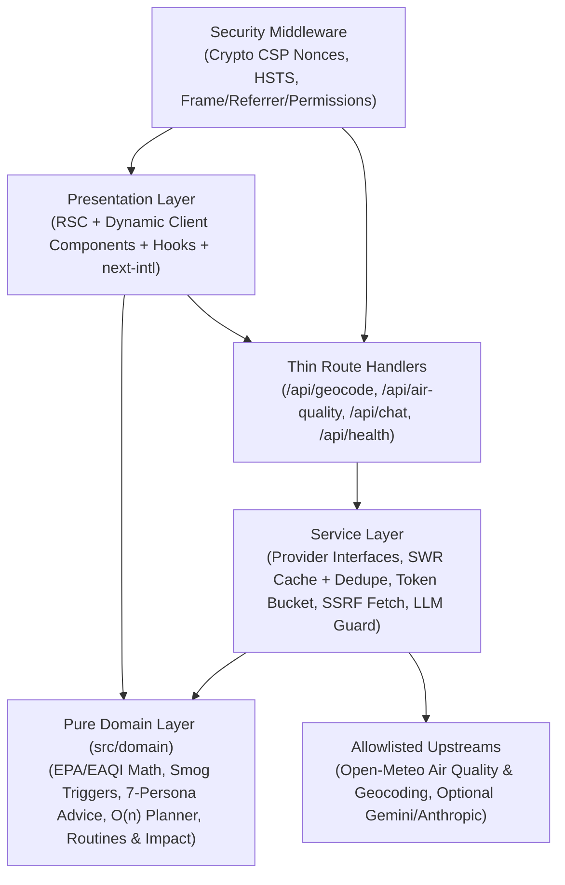

# Urban Air Quality Assistant (Challenge 6)

[](.github/workflows/ci.yml)
[](LICENSE)

> **Official Challenge 6 Goal**: _"Create a GenAI-powered assistant that helps families and communities navigate severe winter smog and urban air pollution. The application should suggest low-emission daily routines, indoor air quality hacks, and sustainable alternatives tailored to their location and lifestyle, while clearly explaining the direct impact of their choices."_

A production-grade Next.js 15 App Router web application built for **zero-API-key operation** (Open-Meteo live telemetry + seeded offline Demo Mode + deterministic grounded fallback AI), **WCAG 2.2 accessibility** (`100` Lighthouse Accessibility, `0` axe-core violations), and **defense-in-depth security** (`0` high/critical vulnerabilities).

---

## Key Capabilities

- **City Autocomplete & Private Geolocation**: ARIA APG combobox search (`300 ms` debounce + `AbortController`) and `"Use my location"` with graceful denial fallback and zero location persistence.
- **Dual AQI & Winter Smog Intelligence**: Simultaneous **US AQI** and **European AQI** badges pairing color + distinct SVG icons + text labels (never color alone), dominant pollutant, and automatic winter smog / atmospheric inversion warnings.
- **WHO 2021 Pollutant Breakdown**: `PM2.5`, `PM10`, `NO2`, `O3`, `SO2`, and `CO` concentrations (`µg/m³`) compared against WHO 2021 guidelines with plain-language explanations.
- **Accessible 48-Hour Forecast & 7-Day Trend**: Declarative SVG line and stripe-patterned bar charts paired with toggleable semantic HTML data tables.
- **Family Guidance & Indoor Air Hacks**: Tailored mask fit, window sealing/ventilation, and outdoor limits across **7 household personas** (`general`, `children`, `elderly`, `asthma`, `pregnant`, `athlete`, `worker`), plus contextual indoor air hacks (HEPA zones, DIY MERV-13 box-fan filters, wet mopping, kitchen exhaust/induction swaps).
- **Transparent $O(n)$ Activity Planner**: Single-pass hourly scoring for **Run**, **Cycle**, **Walk**, and **Open Windows** displaying the formula components and best/worst hours.
- **Low-Emission Routines & Direct Impact Simulator**: Interactive routine toggles quantifying personal `PM2.5` inhalation avoided (`µg`) and community `CO2e` and `NOx` prevented (`g`).
- **Grounded GenAI Assistant**: Server-side Gemini or Anthropic completion with prompt-injection defense, off-topic/override refusal, `"Not medical advice"` disclaimer, data attribution, and deterministic rule-based fallback (`en` / `hi` / `ta`) when zero keys are set.
- **Side-by-Side Comparison & Local Alerts**: Compare up to 3 cities (`Delhi`, `Coimbatore`, `Mumbai`, `London`, `Beijing`, or any searched city) and persist local threshold rules (`e.g., US AQI > 100`) in `localStorage`.
- **Multilingual Support**: Dynamic runtime toggle across **English (`en`)**, **Hindi (`hi`)**, and **Tamil (`ta`)** updating `<html lang>` with zero hardcoded component strings.

---

## Architecture Overview



Further documentation:

- [Architecture Guide](docs/ARCHITECTURE.md)
- [Requirements Specification](docs/REQUIREMENTS.md)
- [Security & STRIDE Threat Model](docs/SECURITY.md)
- [Accessibility Conformance (WCAG 2.2)](docs/ACCESSIBILITY.md)
- [Performance & Bundle Budgets](docs/PERFORMANCE.md)
- [Dependencies Justification](docs/DEPENDENCIES.md)
- [Demo Video Walkthrough Script](docs/DEMO_SCRIPT.md)
- [Self-Audit Scorecard](docs/SELF_AUDIT.md)

---

## Setup in Under 5 Minutes (Zero API Keys Required)

### Prerequisites

- **Node.js** `>= 20` (tested with Node `22`/`24`) and **npm** `>= 10`.

### Quick Start

```bash
git clone https://github.com/Sayandevxyz/urban-air.git
cd urban-air
npm install
npm run dev
```

Open **`http://localhost:3000`**.

- **Zero-Key Mode**: Works immediately out of the box! Toggle **Demo mode** in the header anytime (or set `NEXT_PUBLIC_DEFAULT_DEMO_MODE=true` in `.env.local`) for deterministic offline inspection across `Delhi`, `Coimbatore`, `Mumbai`, `London`, and `Beijing`, or leave Demo mode off for live Open-Meteo data.
- **Optional GenAI Keys**: Copy `.env.example` to `.env.local` and set `GEMINI_API_KEY` or `ANTHROPIC_API_KEY`. If omitted, `LLM_PROVIDER=auto` automatically runs the deterministic grounded fallback engine.

### Production Build & Full Verification

```bash
npm run verify
npm run test:e2e
npm start
```

---

## Scripts Reference

| Script          | Command                                                                     | Purpose                                                                                |
| --------------- | --------------------------------------------------------------------------- | -------------------------------------------------------------------------------------- |
| `dev`           | `next dev`                                                                  | Start development server at `http://localhost:3000`                                    |
| `build`         | `next build`                                                                | Compile production App Router build                                                    |
| `start`         | `next start`                                                                | Serve production build locally                                                         |
| `analyze`       | `cross-env ANALYZE=true next build`                                         | Generate Webpack Bundle Analyzer HTML reports                                          |
| `lint`          | `eslint . --max-warnings=0`                                                 | Enforce TypeScript strictness, `jsx-a11y`, `security`, and import order                |
| `typecheck`     | `tsc --noEmit`                                                              | Run strict TypeScript check (`noUncheckedIndexedAccess`, `exactOptionalPropertyTypes`) |
| `format`        | `prettier --write .`                                                        | Format all repository files                                                            |
| `format:check`  | `prettier --check .`                                                        | Verify deterministic formatting in CI                                                  |
| `test`          | `vitest run`                                                                | Run unit, component, security, and MSW integration tests                               |
| `test:coverage` | `vitest run --coverage`                                                     | Run Vitest suite with V8 coverage thresholds                                           |
| `test:e2e`      | `playwright test`                                                           | Run Chromium Desktop & Mobile E2E + `@axe-core/playwright` audits                      |
| `test:a11y`     | `playwright test tests/e2e/a11y.spec.ts`                                    | Run standalone light/dark WCAG 2.2 axe-core scans                                      |
| `audit:deps`    | `npm audit --audit-level=high`                                              | Check dependencies for high/critical advisories (`0` vulnerabilities)                  |
| `verify`        | `lint && typecheck && format:check && test:coverage && build && audit:deps` | Complete local & CI release gate                                                       |

---

## Environment Variables

All environment variables are parsed and validated once via Zod in `src/lib/env.ts` (see `.env.example`). Client-exposed `NEXT_PUBLIC_*` names containing secret keywords (`key`, `secret`, `token`, `password`) throw an immediate `CONFIG_ERROR`.

| Variable                          | Required | Default                                     | Purpose                                                                          |
| --------------------------------- | -------- | ------------------------------------------- | -------------------------------------------------------------------------------- |
| `NODE_ENV`                        | No       | `development`                               | Runtime mode (`development` \| `test` \| `production`)                           |
| `NEXT_PUBLIC_DEFAULT_DEMO_MODE`   | No       | `false`                                     | Start UI in seeded offline Demo Mode (`true` \| `false`)                         |
| `OPEN_METEO_AIR_QUALITY_BASE_URL` | No       | `https://air-quality-api.open-meteo.com/v1` | HTTPS allowlisted Open-Meteo Air Quality base URL                                |
| `OPEN_METEO_GEOCODING_BASE_URL`   | No       | `https://geocoding-api.open-meteo.com/v1`   | HTTPS allowlisted Open-Meteo Geocoding base URL                                  |
| `LLM_PROVIDER`                    | No       | `auto`                                      | Assistant engine selector (`auto` \| `gemini` \| `anthropic` \| `fallback`)      |
| `GEMINI_API_KEY`                  | No       | —                                           | Server-only Google Gemini API key                                                |
| `GEMINI_MODEL`                    | No       | `gemini-2.5-flash`                          | Gemini model identifier                                                          |
| `ANTHROPIC_API_KEY`               | No       | —                                           | Server-only Anthropic Claude API key                                             |
| `ANTHROPIC_MODEL`                 | No       | `claude-3-5-haiku-latest`                   | Anthropic model identifier                                                       |
| `RATE_LIMIT_MAX_REQUESTS`         | No       | `60`                                        | Token-bucket request capacity per window (`1`–`10000`)                           |
| `RATE_LIMIT_WINDOW_MS`            | No       | `60000`                                     | Token-bucket refill window in milliseconds                                       |
| `LOG_LEVEL`                       | No       | `info`                                      | Structured logger verbosity (`debug` \| `info` \| `warn` \| `error` \| `silent`) |

---

## API Reference

All routes apply security headers via `src/middleware.ts`, per-IP token-bucket rate limiting (`429 RATE_LIMITED` + `Retry-After`), Zod schema validation (`400 VALIDATION_ERROR`), and safe error serialization (`src/lib/errors.ts`).

| Endpoint           | Method | Parameters / Body                                                                                                                    | Responses                                                                                                      |
| ------------------ | ------ | ------------------------------------------------------------------------------------------------------------------------------------ | -------------------------------------------------------------------------------------------------------------- |
| `/api/health`      | `GET`  | None                                                                                                                                 | `200 { status: "ok", llmConfigured: boolean, demoModeDefault: boolean }` (`Cache-Control: no-store`)           |
| `/api/geocode`     | `GET`  | Query: `q` (2–80 valid city chars), `demo` (`"true"` \| `"false"`)                                                                   | `200 { results: CityLocation[], source }`, `400`, `429`, `502`/`504`                                           |
| `/api/air-quality` | `GET`  | Query: `cityKey` (`[a-z0-9-]+`) OR (`lat` `[-90,90]` & `lon` `[-180,180]`), optional `name`, `region`, `country`, `timezone`, `demo` | `200 { report: AirQualityReport }` (`private, no-store` for raw coordinates), `400`, `404`, `429`, `502`/`504` |
| `/api/chat`        | `POST` | JSON <= 16 KiB: `{ message (<=500 chars), locale, profile, airQualityContext }`                                                      | `200 { reply, engine, refused, dataSource, updatedAtIso, disclaimer }`, `400`, `413`, `429`                    |

---

## Design Decisions & Trade-Offs

1. **Pure Domain Layer (`src/domain`)**: Separating US EPA breakpoints, EAQI band computation, smog inversion heuristics, persona guidance, $O(n)$ window scoring, and emission math from HTTP/React yielded **100% line/branch/statement/function test coverage** across core logic with zero mocks required.
2. **Custom SVG Charts vs. Charting Libraries**: Building accessible inline SVG charts with diagonal bar patterns and synchronized HTML data tables avoided ~120+ kB of runtime charting JS, keeping `/` First Load JS at **137 kB** (`< 150 kB` gzip budget). Trade-off: custom SVG coordinates must be maintained manually if additional series types are added later.
3. **SSRF-Allowlisted Native `fetch` vs. LLM SDKs**: Calling Gemini/Anthropic REST endpoints via `fetchJsonWithGuard` avoids heavy transitive SDK dependencies and enforces HTTPS allowlists, timeouts, and byte limits uniformly.
4. **CSP `script-src 'self' 'nonce-...'` without `'strict-dynamic'`**: Next.js 15 `next/dynamic` emits `<link rel="preload" as="script">` tags without a `nonce`, which `'strict-dynamic'` blocks by disabling `'self'`. Keeping strict per-request nonces alongside `'self'` prevents `'unsafe-inline'` scripts while allowing code-split App Router chunks with **0 console errors**.
5. **In-Memory SWR Cache & Rate Limiter Behind Interfaces**: Both `RateLimiter` (`src/services/rate-limit.ts`) and bounded LRU caching (`src/services/cache.ts`) avoid external infrastructure during local evaluation, while typed interfaces allow single-file Redis substitution in clustered deployments.

---

## Requirement Traceability Matrix (`R1`–`R26`)

| ID      | Requirement Summary                                                                         | Primary Implementation File(s)                                                                                                 | Automated Verification Test(s)                                                                                                                                         |
| ------- | ------------------------------------------------------------------------------------------- | ------------------------------------------------------------------------------------------------------------------------------ | ---------------------------------------------------------------------------------------------------------------------------------------------------------------------- |
| **R1**  | City search autocomplete (`300 ms` debounce, `AbortController`, ARIA APG combobox)          | `src/hooks/useCitySearch.ts`, `src/components/CitySearchBar.tsx`, `src/app/api/geocode/route.ts`                               | `tests/unit/hooks.test.tsx`, `tests/components/search-compare-alerts-chat.test.tsx`, `tests/integration/api-routes.test.ts`, `tests/e2e/urban-air.spec.ts`             |
| **R2**  | `"Use my location"` with denial fallback & zero coordinate persistence                      | `src/hooks/useAirQualityData.ts`, `src/components/CitySearchBar.tsx`                                                           | `tests/unit/hooks.test.tsx`, `tests/components/search-compare-alerts-chat.test.tsx`                                                                                    |
| **R3**  | Live dashboard: US/EAQI scales, category icon+color+text, dominant pollutant, timestamp     | `src/domain/aqi.ts`, `src/components/aqiVisuals.ts`, `src/components/icons/AqiIcons.tsx`, `src/components/AqiDashboard.tsx`    | `tests/unit/domain-aqi.test.ts`, `tests/components/dashboard-and-forecast.test.tsx`, `tests/e2e/a11y.spec.ts`                                                          |
| **R4**  | Severe winter smog & inversion detection + emergency advisories                             | `src/domain/aqi.ts`, `src/components/AqiDashboard.tsx`, `src/lib/constants.ts`                                                 | `tests/unit/domain-aqi.test.ts`, `tests/components/dashboard-and-forecast.test.tsx`, `tests/e2e/urban-air.spec.ts`                                                     |
| **R5**  | Pollutant breakdown (`PM2.5`, `PM10`, `NO2`, `O3`, `SO2`, `CO`) vs. WHO 2021 limits         | `src/domain/aqi.ts`, `src/lib/constants.ts`, `src/components/AqiDashboard.tsx`, `src/i18n/messages/*.json`                     | `tests/unit/domain-aqi.test.ts`, `tests/components/dashboard-and-forecast.test.tsx`                                                                                    |
| **R6**  | 48-hour forecast + 7-day trend SVG charts and semantic table toggle                         | `src/components/ForecastSection.tsx`, `src/services/open-meteo.ts`, `src/services/demo-data.ts`                                | `tests/components/dashboard-and-forecast.test.tsx`, `tests/e2e/urban-air.spec.ts`, `tests/e2e/a11y.spec.ts`                                                            |
| **R7**  | Personalized health guidance across 7 personas (masks, windows, activity)                   | `src/domain/guidance.ts`, `src/components/GuidanceSection.tsx`                                                                 | `tests/unit/domain-guidance.test.ts`, `tests/components/guidance-routines-planner.test.tsx`, `tests/e2e/urban-air.spec.ts`                                             |
| **R8**  | Contextual indoor air quality hacks adapted to home setup & pollution                       | `src/domain/guidance.ts`, `src/components/GuidanceSection.tsx`                                                                 | `tests/unit/domain-guidance.test.ts`, `tests/components/guidance-routines-planner.test.tsx`                                                                            |
| **R9**  | Low-emission daily routines tailored to location & lifestyle                                | `src/domain/routines.ts`, `src/components/RoutinesImpactSection.tsx`                                                           | `tests/unit/domain-routines-impact.test.ts`, `tests/components/guidance-routines-planner.test.tsx`                                                                     |
| **R10** | Direct impact simulator (personal `PM2.5` avoided + community `CO2e`/`NOx`)                 | `src/domain/impact.ts`, `src/components/RoutinesImpactSection.tsx`                                                             | `tests/unit/domain-routines-impact.test.ts`, `tests/components/guidance-routines-planner.test.tsx`                                                                     |
| **R11** | Transparent $O(n)$ activity planner (Run/Cycle/Walk/Ventilate)                              | `src/domain/planner.ts`, `src/components/ActivityPlanner.tsx`                                                                  | `tests/unit/domain-planner.test.ts`, `tests/components/guidance-routines-planner.test.tsx`, `tests/e2e/urban-air.spec.ts`                                              |
| **R12** | Grounded GenAI assistant (Gemini/Anthropic + zero-key fallback + disclaimer)                | `src/services/assistant.ts`, `src/app/api/chat/route.ts`, `src/components/AirQualityChat.tsx`                                  | `tests/unit/assistant-security.test.ts`, `tests/integration/chat-route.test.ts`, `tests/components/search-compare-alerts-chat.test.tsx`, `tests/e2e/urban-air.spec.ts` |
| **R13** | Side-by-side comparison of up to 3 cities (`Promise.all` parallel fetches)                  | `src/hooks/useCityComparison.ts`, `src/components/CityCompareSection.tsx`                                                      | `tests/unit/hooks.test.tsx`, `tests/components/search-compare-alerts-chat.test.tsx`, `tests/e2e/urban-air.spec.ts`                                                     |
| **R14** | Local threshold alerts persisted in browser `localStorage`                                  | `src/domain/alerts.ts`, `src/hooks/useLocalAlerts.ts`, `src/components/ThresholdAlertsSection.tsx`                             | `tests/unit/domain-alerts.test.ts`, `tests/unit/hooks.test.tsx`, `tests/components/search-compare-alerts-chat.test.tsx`                                                |
| **R15** | Language toggle (`en`, `hi`, `ta`) via `next-intl` with `<html lang>` sync                  | `src/i18n/catalog.ts`, `src/i18n/messages/{en,hi,ta}.json`, `src/components/LocaleContext.tsx`, `src/components/AppHeader.tsx` | `tests/unit/i18n.test.ts`, `tests/e2e/urban-air.spec.ts`                                                                                                               |
| **R16** | Async loading, empty, error, offline snapshot cache, and `429` rate-limit states            | `src/hooks/useAirQualityData.ts`, `src/components/StatusBanner.tsx`, `src/hooks/useCitySearch.ts`                              | `tests/unit/hooks.test.tsx`, `tests/components/search-compare-alerts-chat.test.tsx`, `tests/integration/api-routes.test.ts`                                            |
| **R17** | Pluggable `AirQualityProvider`/`GeocodingProvider` + Demo Mode presets                      | `src/services/providers.ts`, `src/services/open-meteo.ts`, `src/services/demo-data.ts`, `src/services/container.ts`            | `tests/unit/services-edge.test.ts`, `tests/integration/api-routes.test.ts`                                                                                             |
| **R18** | Layered architecture, strict TS config, ESLint/Prettier zero-warning hygiene                | `tsconfig.json`, `eslint.config.mjs`, `.prettierrc.json`, `src/domain/*`, `src/services/*`                                     | `npm run lint`, `npm run typecheck`, `npm run format:check`, `scripts/audit.sh`                                                                                        |
| **R19** | Zod input & env validation, centralized `AppError`, `Result<T, AppError>`                   | `src/lib/env.ts`, `src/lib/errors.ts`, `src/services/schemas.ts`, `src/app/api/*/route.ts`                                     | `tests/unit/env.test.ts`, `tests/unit/errors.test.ts`, `tests/integration/api-routes.test.ts`, `tests/integration/chat-route.test.ts`                                  |
| **R20** | Security headers (nonce CSP, HSTS, Frame/Content/Permissions) & SSRF guard                  | `src/middleware.ts`, `src/services/security-headers.ts`, `src/services/http.ts`                                                | `tests/unit/security-http.test.ts`, `tests/unit/services-edge.test.ts`, `tests/e2e/urban-air.spec.ts`                                                                  |
| **R21** | Per-IP token-bucket `RateLimiter` (`429` + `Retry-After`) & coordinate redaction logs       | `src/services/rate-limit.ts`, `src/lib/logger.ts`, `src/services/container.ts`                                                 | `tests/unit/rate-limit.test.ts`, `tests/unit/logger.test.ts`, `tests/integration/api-routes.test.ts`                                                                   |
| **R22** | Prompt-injection sanitization, delimiter stripping, refusal, plain-text chat render         | `src/services/assistant.ts`, `src/components/AirQualityChat.tsx`                                                               | `tests/unit/assistant-security.test.ts`, `tests/integration/chat-route.test.ts`, `scripts/audit.sh`                                                                    |
| **R23** | Server SWR cache + dedupe, parallel fetch, dynamic chunks (< 150 kB), < 10 MB repo          | `src/services/cache.ts`, `src/components/UrbanAirWorkbench.tsx`, `src/app/icon.svg`, `src/app/globals.css`                     | `tests/unit/cache.test.ts`, `npm run analyze`, `docs/PERFORMANCE.md`, `.github/workflows/ci.yml`                                                                       |
| **R24** | WCAG 2.2 AA/AAA semantics, contrast, focus, 44+ px targets, 320 px responsive, keyboard nav | `src/app/globals.css`, `src/app/layout.tsx`, `src/components/*.tsx`                                                            | `tests/components/*.test.tsx` (`jest-axe`), `tests/e2e/a11y.spec.ts` (`@axe-core/playwright`), `tests/e2e/urban-air.spec.ts`                                           |
| **R25** | Verified testing pyramid (`97.73%` stmts, `100%` domain coverage, MSW, E2E, deterministic)  | `vitest.config.ts`, `playwright.config.ts`, `tests/**`                                                                         | `tests/unit/*.test.*`, `tests/integration/*.test.ts`, `tests/components/*.test.tsx`, `tests/e2e/*.spec.ts`                                                             |
| **R26** | Complete docs, MIT License, CI/Dependabot, `scripts/audit.sh`, self-audit scorecard         | `README.md`, `CONTRIBUTING.md`, `LICENSE`, `docs/*.md`, `scripts/audit.sh`, `.github/**`                                       | `bash scripts/audit.sh`, `docs/SELF_AUDIT.md`, `npm run verify`                                                                                                        |

---

## Verified Metrics Snapshot

- **Tests & Coverage (`npm run test:coverage`)**: `20` test files / `81` tests passed; **`97.73%` Statements**, **`90.55%` Branches**, **`98.96%` Functions**, **`97.74%` Lines**; **`100%` Stmts / Branch / Funcs / Lines** across `src/domain`.
- **End-to-End & Accessibility (`npm run test:e2e`)**: `6/6` Playwright Chromium checks passed across Desktop (`1280×720`) and Mobile (`Pixel 7`) covering light/dark `axe-core` WCAG 2.2 audits (`0` violations), full workflow, keyboard combobox navigation, language switching (`en`/`hi`/`ta`), `320 px` zero horizontal overflow, security headers, and `0` console errors.
- **Bundles & Performance (`npm run build`, Lighthouse)**: `/` First Load JS **`137 kB`** (`< 150 kB` gzip budget); Desktop Lighthouse **Performance `97`**, **Accessibility `100`**, **Best Practices `100`**, **SEO `100`** (`LCP 0.4 s`, `CLS 0`, `TBT 150 ms`). Under 4× mobile CPU throttling: Accessibility `100`, Best Practices `100`, SEO `100`, `LCP 1.4 s`, `CLS 0`, Performance `73` (full breakdown in [Performance Report](docs/PERFORMANCE.md)).
- **Security Audit (`npm audit --audit-level=high`)**: **`0` vulnerabilities**.

---

## Limitations & Future Roadmap

1. **In-Memory Rate Limit & Cache Store**: Default `InMemoryTokenBucketRateLimiter` and `SWRMemoryCache` are scoped to a single Node instance; deploy behind Redis using the existing `RateLimiter` interface when horizontally scaling across multiple containers.
2. **Real-Time Browser Push Notifications**: Threshold alerts currently trigger accessible live warnings inside the open web session via `localStorage`; background OS push alerts would require Service Worker + Web Push subscriptions.
3. **Seasonal Wildfire vs. Winter Inversion Classification**: Smog detection triggers deterministically on particulate + traffic inversion pollutant ratios; adding meteorological boundary-layer height from Open-Meteo Forecast API would refine meteorological classification further.

---

## Demo Walkthrough

- **Demo Video**: _Placeholder — record using the step-by-step script in [docs/DEMO_SCRIPT.md](docs/DEMO_SCRIPT.md) and replace this line with the public unlisted/hosted link._
- **Contributing**: See [CONTRIBUTING.md](CONTRIBUTING.md).
- **License**: Released under the [MIT License](LICENSE).
