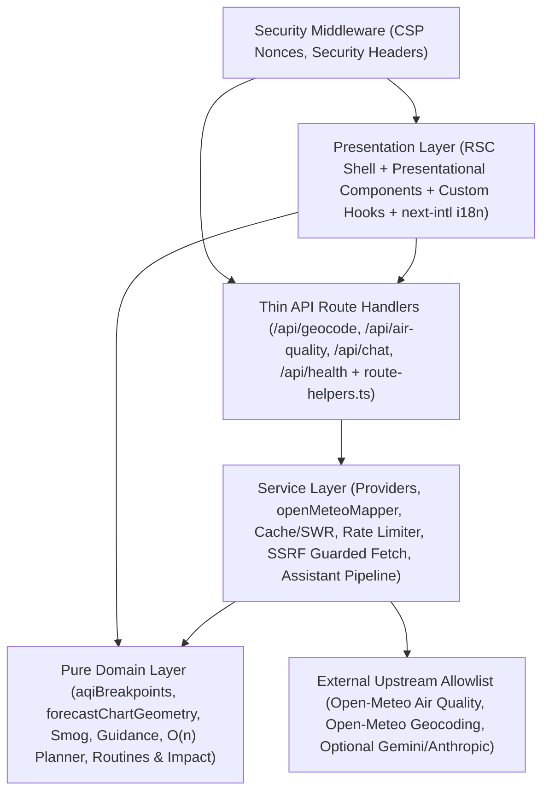

# Architecture — Urban Air Quality Assistant

## Overview

The Urban Air Quality Assistant follows a strict **layered architecture** designed so all air-quality math, smog detection, persona advice, $O(n)$ activity scoring, sustainable routine selection, quantitative impact formulas, and SVG chart geometry live in a dependency-free **Domain Layer** (`src/domain`) that is 100% pure and 100% unit-tested.

## Layer Responsibilities & Module Map

| Layer            | Modules                                                                                                                                                                                                                                                                                                                                                                                                                                                                                                     | Responsibilities & Constraints                                                                                                                                                                                                                                                                                              |
| ---------------- | ----------------------------------------------------------------------------------------------------------------------------------------------------------------------------------------------------------------------------------------------------------------------------------------------------------------------------------------------------------------------------------------------------------------------------------------------------------------------------------------------------------- | --------------------------------------------------------------------------------------------------------------------------------------------------------------------------------------------------------------------------------------------------------------------------------------------------------------------------- |
| **Domain**       | `src/domain/aqi.ts`, `aqiBreakpoints.ts`, `forecastChartGeometry.ts`, `guidance.ts`, `planner.ts`, `routines.ts`, `impact.ts`, `alerts.ts`, `types.ts`                                                                                                                                                                                                                                                                                                                                                      | Pure TypeScript functions & types. Zero I/O, zero `fetch`, zero `process.env`, zero React/DOM globals. Includes SVG coordinate scaling (`forecastChartGeometry.ts`) and EPA breakpoint math (`aqiBreakpoints.ts`).                                                                                                          |
| **Services**     | `src/services/providers.ts`, `open-meteo.ts`, `openMeteoMapper.ts`, `http.ts`, `cache.ts`, `rate-limit.ts`, `route-helpers.ts`, `assistant.ts`, `assistantPrompt.ts`, `assistantSanitize.ts`, `assistantFallback.ts`, `demo-data.ts`, `container.ts`, `schemas.ts`, `security-headers.ts`                                                                                                                                                                                                                   | Provider interfaces, decomposed Open-Meteo adapter/mapper, SSRF-hardened `fetchJsonWithGuard` (`assertAllowedUpstreamUrl`, `buildRequestInit`, `mapHttpStatusToError`, `parseAndValidateBody`), LRU/SWR cache + dedupe, token-bucket rate limiter, route validation helpers, and split LLM safety/prompt/fallback pipeline. |
| **API Routes**   | `src/app/api/{geocode,air-quality,chat,health}/route.ts`                                                                                                                                                                                                                                                                                                                                                                                                                                                    | Thin Next.js Route Handlers delegating boilerplate to `route-helpers.ts` (`withApiHandler`, `parseJsonBody`, `parseGeocodeParams`, `parseAirQualityParams`, `resolveTargetLocation`).                                                                                                                                       |
| **Hooks**        | `src/hooks/apiClient.ts`, `useAsyncResource.ts`, `fetchAirQuality.ts`, `useAirQualityData.ts`, `useGeolocation.ts`, `useCitySearch.ts`, `useCityComparison.ts`, `useLocalAlerts.ts`, `useRoutineInputs.ts`, `useChat.ts`                                                                                                                                                                                                                                                                                    | Shared abort-safe HTTP client (`fetchApiJson`), shared `AbortController` manager (`useAsyncResource`), and focused React state hooks.                                                                                                                                                                                       |
| **Presentation** | `src/components/` (`ForecastSection` -> `HourlyChart`, `DailyTrend`, `ForecastDataTable`; `AqiDashboard` -> `AqiHeadline`, `PollutantGrid`; `GuidanceSection` -> `PersonaPicker`, `AdviceList`; `RoutinesImpactSection` -> `RoutineList`, `CommuteControls`, `ImpactSummary`; `AirQualityChat` -> `ChatMessageList`, `ChatComposer`; `CitySearchBar` -> `SearchComboboxField`, `CitySuggestionsList`; `CityCompareSection` -> `CompareTable`; `ThresholdAlertsSection` -> `AlertRuleForm`, `AlertRuleList`) | Focused presentational components (strictly `<= 80` lines per function, `<= 250` lines per file); see [`src/components/README.md`](../src/components/README.md).                                                                                                                                                            |
| **Shared Core**  | `src/lib/constants.ts`, `env.ts`, `errors.ts`, `json.ts`, `logger.ts`                                                                                                                                                                                                                                                                                                                                                                                                                                       | Named constants with explicit units, Zod-validated `env.ts`, `safeJsonParse` returning `Result<unknown>`, redacted `logger.ts`, centralized `AppError` & `Result`.                                                                                                                                                          |
| **i18n**         | `src/i18n/`                                                                                                                                                                                                                                                                                                                                                                                                                                                                                                 | Typed message catalogs (`en.json`, `hi.json`, `ta.json`) consumed via `next-intl` with complete key parity checked by automated unit tests.                                                                                                                                                                                 |

## Key Design Decisions

1. **Provider Interface Abstraction**: `AirQualityProvider` and `GeocodingProvider` decouple Open-Meteo from the rest of the application, allowing OpenAQ or WAQI adapters to be swapped in without modifying UI or domain logic.
2. **Zero-Dependency SVG Charts + Data Tables**: Custom accessible SVG visualizations (`role="img"`, stroke patterns, `aria-label`) backed by tested pure geometry (`forecastChartGeometry.ts`) paired with toggleable semantic HTML `<table>` views keep first-load JS small while guaranteeing screen-reader parity.
3. **Zero-Key Resilience**: Demo Mode and the deterministic rule-based assistant engine (`assistantFallback.ts`) ensure 100% offline/evaluation functionality even without network access or LLM API keys.
4. **Enforced Structural Limits**: Strict ESLint complexity/size guardrails (`max-lines-per-function`, `complexity: 10`, `max-depth: 3`, `max-params: 4`, `max-lines: 250`) and shared client/server helpers (`apiClient.ts`, `route-helpers.ts`) prevent monolithic drift and duplication (`jscpd < 3%`).
