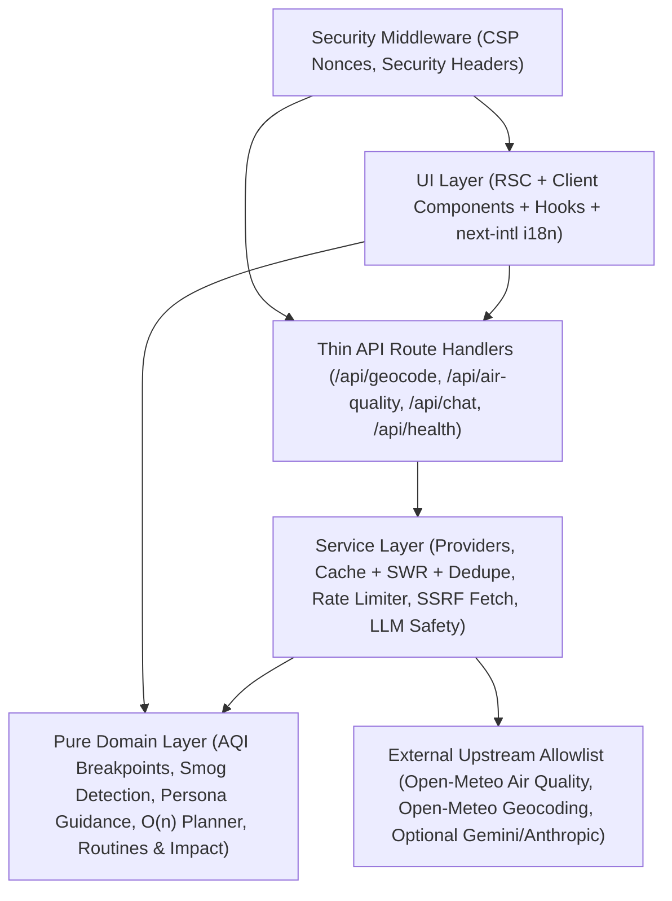

# Architecture — Urban Air Quality Assistant

## Overview

The Urban Air Quality Assistant follows a strict **layered architecture** designed so all air-quality math, smog detection, persona advice, $O(n)$ activity scoring, sustainable routine selection, and quantitative impact formulas live in a dependency-free **Domain Layer** (`src/domain`) that is 100% pure and 100% unit-tested.

## Layer Responsibilities

| Layer            | Directory                                   | Responsibilities & Constraints                                                                                                                                                                                                                                                                       |
| ---------------- | ------------------------------------------- | ---------------------------------------------------------------------------------------------------------------------------------------------------------------------------------------------------------------------------------------------------------------------------------------------------- |
| **Domain**       | `src/domain/`                               | Pure TypeScript functions & types. Zero I/O, zero `fetch`, zero `process.env`, zero React/DOM globals. 100% unit test coverage enforced.                                                                                                                                                             |
| **Services**     | `src/services/`                             | Provider interfaces (`AirQualityProvider`, `GeocodingProvider`), Open-Meteo adapters, seeded Demo provider, SSRF-hardened `fetch`, in-memory LRU/SWR cache with request deduplication, `RateLimiter` interface + token bucket implementation, LLM grounding + injection guard + rule-based fallback. |
| **API Routes**   | `src/app/api/`                              | Thin Next.js Route Handlers: enforce per-IP rate limiting, validate inputs with Zod, invoke services, convert `Result<T, AppError>` into safe JSON responses.                                                                                                                                        |
| **Presentation** | `src/components/`, `src/hooks/`, `src/app/` | Server Components for initial page shell; dynamic-imported Client Components (`charts`, `chat`, `compare`, `routines`) for interactivity and small first-load bundle; accessible WCAG 2.2 AA/AAA controls.                                                                                           |
| **Shared Core**  | `src/lib/`                                  | Named constants with units, Zod-validated `env.ts`, privacy-preserving `logger.ts`, centralized `AppError` & `Result` types.                                                                                                                                                                         |
| **i18n**         | `src/i18n/`                                 | Typed message catalogs (`en.json`, `hi.json`, `ta.json`) consumed via `next-intl` with complete key parity checked by automated unit tests.                                                                                                                                                          |

## Key Design Decisions

1. **Provider Interface Abstraction**: `AirQualityProvider` and `GeocodingProvider` decouple Open-Meteo from the rest of the application, allowing OpenAQ or WAQI adapters to be swapped in without modifying UI or domain logic.
2. **Zero-Dependency SVG Charts + Data Tables**: Custom accessible SVG visualizations (`role="img"`, stroke patterns, `aria-label`) paired with toggleable semantic HTML `<table>` views keep first-load JS small while guaranteeing screen-reader parity.
3. **Zero-Key Resilience**: Demo Mode and the deterministic rule-based assistant engine ensure 100% offline/evaluation functionality even without network access or LLM API keys.
