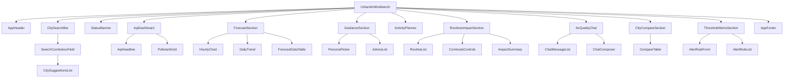

# UI Component Architecture (`src/components`)

Presentational React components and layout modules are intentionally kept barrel-free, small (<= 120–150 lines per file), and accessible (WCAG 2.2 AA/AAA).

## Guardrails Enforced via ESLint (`eslint.config.mjs`)

- Pure hooks/services/domain functions: `max-lines-per-function: 40`, `complexity: 10`, `max-depth: 3`, `max-params: 4`, `max-lines: 250`.
- Component `.tsx` files: `max-lines-per-function: 80` (justified strictly for declarative accessible JSX).
- Zero ESLint disable comments, zero `any`, zero inline `style=` attributes, and zero barrel re-export files.
